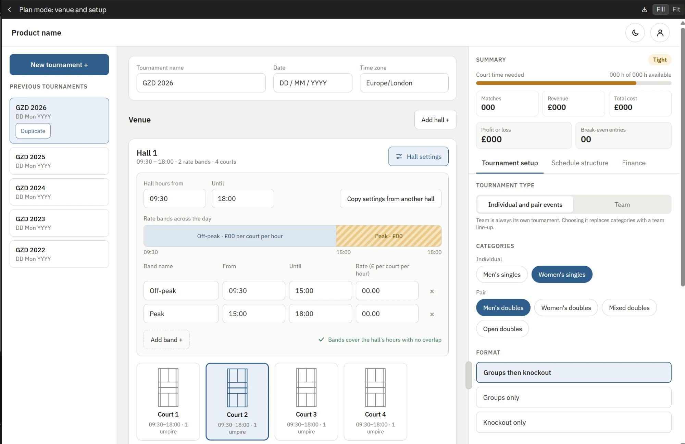
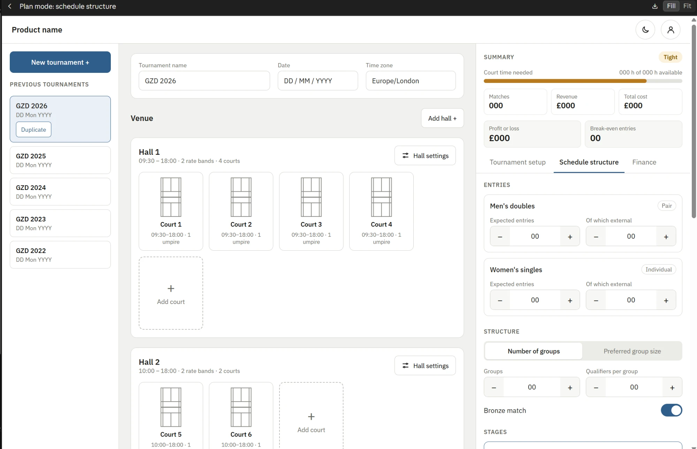
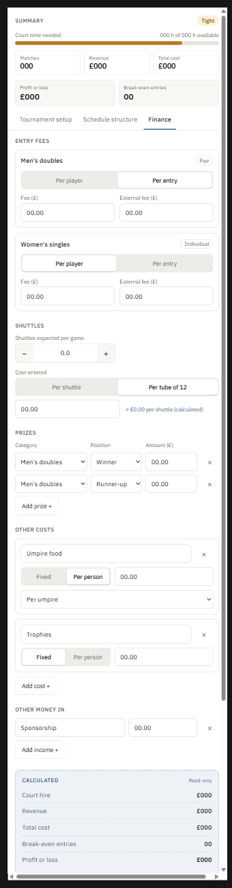

# Wireframe context and decisions to date

A record of the context behind the Plan mode screens: the wireframes, the build brief, and every decision made along the way. Use it to look back on why things are the way they are.

Last updated: 12 October 2026, after build step 2 (venue canvas).

## 1. Sources of truth

| Document | Holds |
|---|---|
| `docs/PRD.md` | Product requirements: what the app must do |
| `docs/IA.md` | Information architecture v3: layout and content of the Plan mode screens. The build brief calls this `docs/information-architecture.md`; it is saved here as `IA.md`. |
| `docs/setup-inputs.md` | Inventory of every planner input, in three tiers. Written before halls existed: court windows, start/end time and a total umpire count have since been replaced by halls, rate bands and courts (section 5). |
| `docs/wireframe-context.md` | This file: wireframes, the brief, decisions and history |
| `CLAUDE.md` | Working rules for the codebase |

If this file and the PRD disagree, the PRD wins and this file should be corrected.

## 2. Wireframes

Three wireframes, supplied on 12 October 2026. They show layout and content, not visual style: a visual direction is still to be supplied (section 5, Design).

### 2.1 Venue and setup

- **Top bar:** "Product name", a theme (moon) button and an account button.
- **Left panel:** "New tournament +" button; "Previous tournaments" as cards (GZD 2026 to GZD 2022, each with a date). The selected card shows a **Duplicate** button.
- **Middle, header card:** Tournament name, Date (DD / MM / YYYY), Time zone (Europe/London).
- **Middle, Venue:** "Venue" heading with "Add hall +".
  - **Hall 1** card: "09:30 – 18:00 · 2 rate bands · 4 courts" and a **Hall settings** button.
  - Hall settings, open inline: Hall hours from / Until; "Copy settings from another hall"; "Rate bands across the day" as a strip (Off-peak plain from 09:30, Peak hatched from 15:00, ticks 09:30 / 15:00 / 18:00); band rows (Band name, From, Until, Rate £ per court per hour, remove ×); "Add band +"; a green check "Bands cover the hall's hours with no overlap".
  - Court cards: a top-down court drawing, "Court 1", "09:30–18:00 · 1 umpire". Court 2 is shown selected.
- **Right, Summary:** "Tight" badge; "Court time needed: 000 h of 000 h available" with a bar; tiles for Matches, Revenue, Total cost, Profit or loss, Break-even entries.
- **Right, Tournament setup tab:**
  - Tournament type as a segmented control: "Individuals and pairs" / "Team". Note: "Team is always its own tournament. Choosing it replaces categories with a team line-up."
  - Categories as chips. Individual: Men's singles, Women's singles. Pair: Men's doubles, Women's doubles, Mixed doubles, Open doubles.
  - Format as large options: Groups then knockout, Groups only, Knockout only.

### 2.2 Schedule structure

- **Middle:** Hall 1 with Courts 1–4 and a dashed "Add court" card; Hall 2 ("10:00 – 18:00 · 2 rate bands · 2 courts") with Courts 5–6, so court numbering continues across halls.
- **Right, Schedule structure tab:**
  - **Entries:** a card per category (e.g. Men's doubles, tagged "Pair"; Women's singles, tagged "Individual") with steppers for "Expected entries" and "Of which external".
  - **Structure:** segmented "Number of groups" / "Preferred group size"; steppers for Groups and Qualifiers per group; a Bronze match switch.
  - **Stages:** stage cards (cut off in the wireframe).

### 2.3 Finance

- **Entry fees:** a card per category with a "Per player / Per entry" segmented control, Fee (£) and External fee (£).
- **Shuttles:** "Shuttles expected per game" stepper; "Cost entered" as "Per shuttle / Per tube of 12" with an amount and "= £0.00 per shuttle (calculated)".
- **Prizes:** rows of Category, Position (Winner, Runner-up), Amount (£), with remove; "Add prize +".
- **Other costs:** cards (e.g. Umpire food: Per person, Per umpire; Trophies: Fixed) with "Add cost +".
- **Other money in:** rows (e.g. Sponsorship, amount) with "Add income +".
- **Calculated (read-only):** Court hire, Revenue, Total cost, Break-even entries, Profit or loss.

## 3. The build brief: Plan mode screens

**Goal.** Replace the spreadsheet-style setup form with the three-area layout from the wireframes: tournament list on the left, venue canvas in the middle, workbench on the right.

**Scope.** Plan mode only, desktop only. **Out of scope:** Live mode, mobile layouts, draw and fixture generation, auth and roles.

**Main points of the brief**
- **App shell:** top bar (product name placeholder, account icon, light/dark toggle); left panel (New tournament, previous tournaments, most recent first); middle (inline-editable name, date and time zone, then the venue canvas, then the timeline); right workbench with a draggable width that is remembered between sessions.
- **Venue canvas:** halls containing court cards and an Add court card; Add hall below the halls.
  - Hall settings: hall hours, rate bands (new halls start with one band covering the hall's hours), a strip showing the bands across the day, validation (bands must not overlap and must cover the hours; gaps shown clearly), copy settings from another hall.
  - Court details: available from and until (defaults to the hall's hours; can be narrowed), umpires on the court, copy from the previous court, delete court.
  - Court hire per court: available time within each rate band × that band's rate. Only booked time is charged.
  - Timeline: one overall timeline with a lane per hall, rate bands as background shading, and each court's availability. Built so it can later show stages and match waves.
- **Workbench:**
  - Sticky summary: fit status, court time needed against available, total matches, revenue, total cost, profit or loss, break-even entries. Updates live.
  - Tournament setup tab: tournament type, categories, format, and rules (tiebreak order as an orderable list, handicap, eligibility, withdrawal rules, walkover rules). Rules are stored for the tournament, not per category. Individual and pair categories can be mixed. Open doubles is available under pair as well as team.
  - Schedule structure tab: expected entries with expected external entries; groups or preferred group size, qualifiers, bronze; a card per stage; buffer; a derived block (group size, matches, matches per entry in the group stage, waves in the group stage, total play time, court time needed, fit status, suggested wave distribution for multiple halls).
  - Finance tab: entry fees with an external fee; shuttles per game with a per shuttle / per tube of 12 toggle; prizes, other costs, other money in; a derived block; suggested levers as what-if cards that re-run the engine with one changed input and show the change in fit and profit (they suggest, never apply).
- **Inputs vs derived:** inputs are form controls; derived values are read-only and never look editable. No spreadsheet-style tables for inputs: cards, segmented controls, steppers and inline lists.
- **Behaviour:** recalculate live; keep the draft autosave; editing the venue or setup flags the tuned values it affects and never changes them silently; dependent fields (type decides the category form, format decides the format fields, any best-of-3 stage reveals the allowance, categories feed the prize list); duplicate tournament copies everything except name, date and results; inline validation and empty states.
- **Data and engine:** halls replace court windows; total umpires is derived from umpires per court; per-band court hire; add expected external entries, the per-tube shuttle option, other money in and the rules settings; migrate existing drafts.
- **Design:** shadcn/ui and Tailwind with tokens; light and dark; generous spacing, clear hierarchy, subtle motion; court cards with a simple top-down court drawing.

**Build order (each step demoable, each planned before code)**
1. Shell and layout: three areas, resizable right panel, sticky summary showing real engine values. **Done.**
2. Venue canvas: halls, courts, court details, hall rate bands, validation, the court hire engine change. **Done.**
3. Tournament setup tab, including rules.
4. Schedule structure tab.
5. Finance tab, including suggested levers.
6. Timeline.
7. Previous tournaments list and duplicate tournament.

**Acceptance**
- Changing any input updates the sticky summary immediately.
- A hall with peak and off-peak bands produces the correct court hire.
- A mixed singles and doubles tournament can be set up; a team tournament cannot include them.
- A duplicated tournament carries over everything except name, date and results.
- No tournament values are hard-coded in application code.
- Typecheck, lint and tests pass.

## 4. Where the brief and earlier decisions differ (as settled)

| Brief says | Settled as | Why |
|---|---|---|
| Lucide icons | **Phosphor** | The user kept the icon set already in use (CLAUDE.md says Phosphor). |
| Do not invent a brand | **Neutral tokens** | The earlier sporty high-contrast direction was withdrawn on 12 Oct; neutral until a direction is supplied. |
| Minutes per game and organising time on each stage card | **Per stage** (built in step 4) | The user chose the brief's model, reversing the 10 Oct per-event timing. |
| Stage cards: group, knockout, finals | **Four cards**: group, knockout rounds, bronze, final | The user kept bronze separate. |
| Structure block shown once | **Per category** | Each category keeps its own groups, qualifiers and bronze. |
| Category chips (one per event) | **Several categories per event**, each renameable | e.g. Men's doubles A and B. |
| Court details panel (placement not specified) | **Floating panel beside the selected court**; the hall's other courts dim | User's choice. |

## 5. Decisions log

### Platform and tooling
- Next.js 16 (App Router), TypeScript strict, Supabase (connected; no tables yet), Vercel from `main`, Vitest. Repo: `DipendraSingh96/Badminton-Tournament-App`.
- Calculations live in `src/engine/` as pure functions with tests; ESLint blocks UI, framework and database imports there.
- Plans are saved in the browser (localStorage) until sign-in arrives in build slice 4. Saved shape: `badminton:plan-draft:v4`; older v3 drafts are migrated on load.
- Plan mode is desktop only (minimum width 1024 px), per the IA.

### Design
- 10 Oct: sporty high-contrast (shuttle yellow) chosen via the taste-skill. **Withdrawn 12 Oct:** neutral shadcn tokens until a visual direction is supplied.
- Light and dark themes with a toggle (next-themes), following the device until chosen.
- Status colours are semantic: success (fits, pays), warning (tight), destructive (doesn't fit, loss).
- Icons: Phosphor. Product name placeholder: "Tournament planner" (`src/lib/product.ts`).
- Accessibility: WCAG AA for text; at least 3:1 for input outlines and focus rings.

### Scope changes to the PRD (10 Oct)
- Teams, singles, and knockout-only and groups-only formats were brought into scope.

### Tournament structure
- Unit of play (tournament type) chosen once: individual and pair events, or team. Team is always its own tournament.
- Events: men's singles, women's singles, men's doubles, women's doubles, mixed doubles, Open doubles (doubles only: men's, women's and mixed pairs together).
- Format chosen once per tournament: groups then knockout, knockout only, or groups only. Structure (groups or preferred group size, qualifiers, bronze) is per category.
- Knockout only: every entry goes into the bracket; byes fill it; bronze needs at least four entries.
- Labels: individual events say "Expected entries"; team events say **"Expected teams"** with the people it means shown underneath (e.g. "= 48 pairs, 96 players").

### Teams
- The organiser sets the line-up of a tie: a rubber count for each of the six events. All rubbers are always played; the team winning most rubbers wins the tie.
- Each player plays one rubber, so a team's squad is the players its line-up needs (one per singles rubber, two per doubles rubber). No reserves.

### Time and scoring
- Scoring (points per game, deuce rule and cap/maximum, best of 1 or 3) is set per stage and applies to every event.
- Timing: set per event type since 10 Oct (minutes per game, organising time per match). **To move to the stage cards in step 4** (section 4).
- Best-of-3 allowance (11 Oct), set once by the organiser: typical best-of-3 length = (2 × minutes per game + organising) × (1 + allowance), capped at the worst case. Shuttle use for best of 3 gets the same allowance. Best of 1 is unaffected.
- Worst case: every game played, each at its longest possible length (from the deuce rule), plus organising.

### Venue (12 Oct)
- Halls have hours, rate bands (from, until, rate per court per hour) and courts. Bands must cover the hall's hours with no overlap; gaps and overlaps are named with their times.
- The day runs from the earliest hall opening to the latest closing. There is no separate tournament start or end time.
- Buffer is held back at the end of the whole day; a hall that closes earlier is unaffected. It is set in the Schedule structure tab.
- Court availability defaults to its hall's hours (stored as "follow the hall") and can be narrowed. Courts are numbered across halls.
- Umpires are set per court; the total feeds "per umpire" costs.
- Court hire per court: booked availability within each band × the band's rate. Booked time is charged, buffer included.
- Migration from court windows: each old window became a hall with one band at its rate and that many courts; the old umpire total was shared across courts.

### Finance
- Entry fee per player or per entry (player, pair or team), with an optional external fee and expected external entrants.
- Other costs: fixed, or per person (per player, per umpire, or a typed number of people).
- Court hire is calculated from the venue, not typed in.
- Break-even is found by re-running the format at each entry count, because entries change the format and the match count.

### Tournament setup and rules (12 Oct)
- Tournament type is a segmented choice: individual and pair events, or team. Switching it once categories exist asks first and replaces them; nothing changes silently.
- Individual and pair categories come from event chips grouped Individual (men's and women's singles) and Pair (men's, women's, mixed and Open doubles). Each click adds a category; an event can be added more than once and the chip shows the count. Unnamed categories take the event's name, numbered from the second ("Men's doubles 2").
- Team tournaments have competition cards: a name and a line-up stepper per event, with the squad worked out from it.
- Format is chosen from three option cards and applies to every category.
- Rules are set once per tournament and stored; the draw, standings and Live mode will apply them:
  - **Tiebreak order:** chosen and ordered from matches won, game difference, point difference, head-to-head, points won (total), rubbers won (teams only) and draw of lots (always last).
  - **Handicap:** Open doubles only, including Open doubles rubbers in team ties. A points head start per game for the weaker pair type, per matchup: mixed vs men's (to the mixed pair), women's vs men's and women's vs mixed (to the women's pair). The same in every stage; off unless switched on.
  - **Eligibility:** most categories one person may enter (optional), pairs of categories that can't be entered together, members-only categories, and whether a member may pair with an external player.
  - **Withdrawals:** a bye before the draw. After play starts, a stored choice: walkovers with played results standing, or all their results voided.
  - **Walkovers:** a stored choice: straight games at the stage's points per game (e.g. 21–0, 21–0), or a win with no games or points.
- Removing a category also removes it from prizes and the eligibility rules.
- Until steps 4 and 5, expected entries (and external entries), groups, qualifiers and bronze sit in an "Entries and structure" block on the Schedule structure tab, and entry fees in an "Entry fees" block on the Finance tab. Values a format doesn't use are kept, with a note.

### Schedule structure (12 Oct)
- Timing is per stage: each stage card holds points per game, deuce rule, games per match, minutes per game and organising time per match, and applies to every event and rubber in the stage. Drafts saved with per-event timing copy it to every stage only when all events in use agree; otherwise stage timing starts empty and is listed as missing.
- Stages the format doesn't play (or bronze when no category has it) show as a collapsed "Not played" card and need no values; values already there are kept.
- "Of which external" is counted in entries (pairs, teams), next to expected entries. A per-player fee multiplies it by the players in an entry. Saved values counted in players were converted.
- A wave is one round of a group: every entry plays at most once in it. A group of n has n − 1 rounds when n is even and n when odd. Categories play their waves side by side, so the group stage has as many waves as its longest category.
- With several halls, the app suggests groups per hall: each group stays in one hall, shared in proportion to each hall's court time, largest groups first. A suggestion only.
- Storage moved to v5; v4 and v3 drafts migrate on load.

### Finance tab and levers (12 Oct)
- Shuttle price is entered per shuttle or per tube; per tube needs the shuttles in a tube (an organiser input, not fixed at 12) and shows the calculated cost per shuttle. Drafts saved with a cost per shuttle keep it as a per-shuttle price.
- Other money in mirrors other costs: a fixed amount, or per person (per player, or a set number of people). Revenue is entry fees plus other money in.
- Break-even varies one category, chosen on the Finance tab (remembered in this browser); the summary follows the choice.
- Suggested levers use natural steps only, so no step size is invented: one more court in a hall; best of 1 instead of best of 3; no deuce; a group more or fewer, or a preferred group size one larger or smaller; no bronze match; the exact fee rise that breaks even (when there's a loss, rounded up to the penny, external fee raised by the same); shuttles per game down to the next whole number (not below 1); without each other cost.
- Each lever re-runs the whole plan. Levers that improve neither fit nor profit are hidden. "To fit" (shown when the plan doesn't fit) lists the court time gained, most first; "To improve profit" lists the profit gained. A lever that helps both is listed under fit. Levers never change the plan.

### Timeline (12 Oct)
- One timeline below the venue: a lane per hall with its rate bands (shaded, named with their rate), a row per court showing its availability, the buffer hatched, and markers for "Play must end", the estimated finish and the worst-case finish.
- The user asked for it to behave like a video timeline: a playhead that can be dragged, clicked to a moment, stepped with the keyboard (5 minutes; Home and End) or played forward (a whole day in about 30 seconds). At the playhead's moment every court card on the venue shows what is running on it: stage, wave or knockout round, and category; or Free / Not booked.
- Until the scheduler is built, the stages come from an estimate: matches placed in order on the first court that can start them, at typical length, within each court's hours. Group waves in order; a category's knockout rounds after its group stage, each round after the last; bronze and final after the semi-finals; team rubbers as separate matches; rest not modelled. Matches that fit nowhere are reported ("N matches don't fit in the day").
- Knockout rounds come from the bracket: byes fill the first round, then quarter-finals, semi-finals and the final.
- Stage colours use the neutral chart tokens (final strongest), with a legend; the playhead isn't saved.

### Changes requested before step 7 (13 Oct)
- **Hall unit time:** each hall has the time it charges by (e.g. 60, 40 or 30 minutes), and band rates are per court per unit. Hire is always whole units: hall hours, band edges and court hours must fall on unit steps from the opening time, and validation says what to fix. Halls saved earlier keep a 60-minute unit, so their per-hour rates stand.
- **Structure inside Stages:** the separate Structure section is gone. Stages run in play order: Group stage (each category's groups set by, number or size, qualifiers per group; then scoring and timing), Knockout rounds, Bronze match (a switch per category, then its scoring and timing), Final. Knockout only shows each category's bracket in the knockout card.
- **Collapsible summary:** a slim bar (fit badge, court time, matches, profit or loss; or what's missing) with a show/hide button, remembered in this browser.
- **Help text in tooltips:** field hints and section descriptions sit behind an ⓘ beside the label or title (hover or keyboard focus; screen readers get it as a description). Errors stay inline; calculated lines (people per team, cost per shuttle, group previews) stay visible. "Select a figure to see how it was worked out" is a tooltip on each results card title.
- Jumping to a hall issue from the summary opens that hall's settings.

### Drag to set times, part 1 (13 Oct)
- A hall's hours are a window that can be dragged on the timeline and on the strip in its settings, with the typed "from / until" fields kept and all three in sync. Drawing a new window starts on a 10-minute grid and lasts whole units of the hall's unit time; afterwards the start edge, end edge and whole window move in whole units. A window can be removed (✕ or Delete) and a new one drawn on the empty lane.
- Moving a whole hall window carries its bands and narrowed courts; moving one edge carries the bands that sat on it.
- Rate band boundaries and court availability drag along the hall's unit steps from its opening. A court dragged back to the hall's hours (or double-clicked, or H) follows the hall again.
- The buffer is drawn straight after the last match. Dragging it pins it: start on the 10-minute grid, length in whole units of the hall that closes last; play must then end by its start. The Buffer card shows the pin with an Unpin button.
- Every handle is keyboard operable (arrows move one unit; Delete removes; H resets a court). The strips share one view of the day (the halls' span with an hour either side), held still during a drag; hour labels thin out on a narrow axis.

### Drag to set times, part 2 (13 Oct)
- A "Stages" lane above the halls has a window per stage and per part of it, in play order: Group stage with Wave 1…N, Knockout rounds with each round (Round of 16, Quarter-finals, Semi-finals), Bronze match, Final.
- Each window follows the estimate (shown dimmed) until dragged on the 10-minute grid, which pins it: what it holds starts no earlier than its start.
- A pinned window too short for its matches lets them run on past its end; later stages wait for the real end. It turns red with a "Needs until …" marker. A window pinned to start before what it depends on has finished turns red with "Can't start before …". The summary lists these as warnings; they don't stop the plan.
- Double-click, H, ✕ or Delete returns a window to the estimate. Pins for waves or rounds no longer played stay, marked "not played".
- On a very narrow timeline a short window (e.g. a 15-minute final) is mostly its edges, so a drag there resizes rather than moves; the keyboard moves it exactly.

### Hall rates (13 Oct)
- A hall has one rate all day by default, entered beside its hours and unit time ("£ per court per 40 min"). "Rate changes during the day" turns on the band strip and band rows; unticking with several bands asks, then keeps the first band's rate across the hall's hours. Saved halls with several bands have it on.
- The band strip is slimmer and its labels read "Off-peak · £8.00 per 40 min". Before the hall's hours are drawn, a line follows the pointer on the strip with the time a new window would start at.

### Timeline per hall (13 Oct)
- From the user's sketch: each hall has its row with its rate bands, then its own **Stages** row, then its court rows. The Stages row holds a Group stage zone and a KO stage zone (knockout rounds, bronze match and final), each labelled with the categories it holds there and shaded across that hall's courts (different patterns for group and KO), so halls can run stages at different times. This replaces the global Stages lane and its wave and round windows.
- Zones follow the estimate until dragged (10-minute grid); a pinned zone holds that stage in that hall to its start, overruns in red ("Needs until …") or shows "Can't start before …"; double-click, H, ✕ or Delete unpins. Earlier global windows are dropped on load.
- Each group plays in its suggested hall, round by round from a round-robin draw (a round is a wave); the knockout uses cross-group seeding (Winner A v Runner-up D…), byes to the top seeds, and may use any hall's courts.
- The wave pills are unchanged. Hovering (or focusing) a pill shows the match under the pointer: category, group and wave or knockout match, the sides as draw slots (Pair A1 v Pair A4, Winner QF3 v Winner QF4), the rubber for team ties, court and time. Names replace the slots once entries and the draw exist. Court cards at the playhead show the same match in short.
- Zones are derived from the group and knockout structure and how long each takes; they are never items to fill in. A dragged zone that no longer fits its hall (for example after the hall's hours change) is ignored and the zone shows the estimate again.
- Only the worst-case finish stays as a vertical line, in red; the "Play must end" and finish lines are gone. The buffer zone and the playhead remain.

### Moving zones and matches by hand (15 Oct)
- Zones are plain labelled shading (no boxes or edges); their length always comes from their matches. A zone can be dragged along the timeline to leave free time mid-tournament (its stage starts no earlier there; red "Can't start before …" if what it depends on isn't finished), or onto another hall's Stages row to move that whole stage there (e.g. all knockout matches into Hall A to see if Hall B can be dropped; matches that then don't fit are reported).
- Each match is its own pill and can be dragged onto any court of its hall, inside its stage's zone; it takes that place and the rest of that court shifts along. Dropping outside the zone or into another hall's group stage is refused with a note.
- Limits always hold: knockout order (a semi-final waits for its quarter-finals; "Winner A" waits for group A) and no pair or team in two ties at once. The hover card says why a match waits.
- Moved matches and zones carry a dot; double-click or H puts one back, and "Reset all moves" clears them all. Alt with the arrow keys moves a focused match (earlier/later, neighbouring court) or zone (Alt+up/down to another hall; arrows shift in time).
- In the engine, placement is two passes: assignment (as before, then moves by hand), then timing in each court's order with feeders, zone starts and side clashes. With no moves the times are as before.

### Stable estimate and copying halls (17 Oct)
- Changing a hall's or court's hours never moves or removes matches. Groups are shared between halls by each hall's number of courts (not court time), and closing times play no part in assigning courts. A match that runs past its court's hours stays where it is with a red outline; its zone turns red with "Runs until …", the timeline says how many run past closing, and the summary names the zone.
- "Copy everything from another hall" (after a confirmation) copies the hours, unit time, rates and courts (each court's hours and umpires).

### Timeline usability (19 Oct)
- From the first design critique (impeccable, 25/40; snapshot in `.impeccable/critique/`). Scope agreed with the user: UX and function only, no visual direction until one is supplied.
- The timeline is docked along the bottom of the working area, with a draggable, remembered height, so the venue cards and the playhead are visible together.
- It opens on the whole day; zoom out/in, "Fit play" (first match to the worst case or buffer) and "Whole day"; Ctrl or Cmd with the scroll wheel zooms at the pointer. The axis and row labels stay in place while scrolling, and playback scrolls to follow the playhead.
- Keyboard: one tab stop per court's matches; arrow keys go between matches and courts, Home and End to the first and last; Alt and the arrows still move a match, and focus follows it. Screen-reader labels include the rubber.
- A short key under the legend says how to move things; the help tip is shorter. Timeline text is at least 12px.
- The worst-case line takes the fit status's colour: neutral when it fits, warning when tight, red when it doesn't fit or matches run past their court's hours. (Earlier it was always red.)

### Court green design system (26 Oct)
- The product owner supplied the visual direction: `docs/design-system.md` and `src/app/design-tokens.css` ("Court green"). Plan mode is restyled first; Live mode and the results page follow on the same tokens.
- Decisions: Plan keeps a dark option (Plan dark, derived from the Live palette, mint primary); the worst-case line keeps following the fit status (recorded as an exception in the system); the Suggested lever's Preview is built now (Preview, then Keep or Discard).
- The reference picture `docs/design/plan-venue-light.png` wasn't available; the written system was followed and the screens should be compared with the picture when it arrives.

### Shell, court face and density (27 Oct)
- The page no longer scrolls as a whole: screen-reader hints in the panes were positioned against the page, so it grew to the workbench's height. Each pane now contains them and the shell clips.
- The left panel collapses to a thin rail, remembered in this browser.
- Hall header: name, chevron for the settings (expanded in place), summary, copy from another hall; Clear hall and Delete hall on the right (Clear only when there is one hall).
- Courts follow the organiser's wireframe (`docs/design/court-face-wireframe.webp`, the middle court): side codes in the halves and "Team A1"-style name bands until names exist in Live; the court number as a watermark; umpire spots toggled anywhere (positions are saved with the court, the count follows); hours stepped by the hall's unit at the bottom; copy and delete at the top. The court popover is gone.
- Density: workbench sections and figure panels are flat, divided by rules; at most one inset level; paired fields sit side by side at the workbench's width.

### Group courts (27 Oct)
- The estimate had put each group match on the first free court in the hall, so one wave of 3-rubber ties filled several rounds and groups mixed across courts. The organiser wants each group on its own courts, waves in order.
- Decisions: a stored setting "Group courts" (own courts per group by default, or shared across the hall); courts split automatically in proportion to each group's matches, editable per court from the court face (the court changes hands; Automatic undoes it); groups sharing a court alternate waves; the knockout uses any free court.

### Group menu, court face and spacing (27 Oct)
- The court's group menu lists every group of the tournament with the courts it has; choosing one adds this court to it (from any hall). No group and Automatic split are offered too. A group left without a court is named in the summary and shares a court meanwhile.
- The net band is one centred line ("Wave 1 · R1/2"); the watermark number is half as strong.
- Spacing is a 4px grid (4, 8, 12, 16, 24px). The summary moved off the deep green card onto the workbench surface, collapsible like a hall.

### Scrollbars and undo (27 Oct)
- Scrollbars are thin and sit within the panes' padding (equal gutter both sides).
- Ctrl+Z / Ctrl+Shift+Z (or Ctrl+Y) undo and redo up to 10 changes, with buttons in the top bar; history is in memory only.

### Stages (29 Oct)
- Slice 2 begins: the tournament has a stage (Plan, Draw, Live, Results) with a switch in the top bar. Moving to Draw switches the plan to the real entries (taken on the Draw stage: typed, pasted or CSV, with team squads and fixed line-ups); a locked draw makes the structure read-only until unlocked. Live and Results wait for the next slice.

### Slice 2 views (29 Oct)
- Draw stage views built: Entries (typed, pasted, CSV; team squads and fixed line-ups), Draw (seeded then random, swaps, redraw, lock), Courts (names on courts and timeline, court panel and call-up list), Teams (search, check-in, every team's matches), Groups (tables at zero with the cut line until Live) and Bracket (the knockout with times and courts).
- Withdrawing an absent entry, results, live standings and the moving bracket come with Live (slice 3).

### Workbench and dashboard
- Sticky summary always visible; break-even uses the category chosen on the Finance tab (the first by default).
- Every figure can be opened to show its working, with exact minutes so each line adds up.
- The summary lists what is missing and jumps to the field.

## 6. Build status

| Step | Status | Notes |
|---|---|---|
| Earlier slice 1 work (engine, plan form, dashboard) | Done | Commits from 7 to 11 Oct. |
| 1. Shell and layout | Done | Commits `3210483`, `13a0cb3` (12 Oct). |
| 2. Venue canvas | Done | Commits `5a7ca2c` to `c56e3ac` (12 Oct). |
| 3. Tournament setup tab and rules | Done | Commits `75d8383` to `a25ae1d` (12 Oct). |
| 4. Schedule structure tab | Done | Commits `fef582d` onwards (12 Oct). |
| 5. Finance tab and suggested levers | Done | Commits from the step 5 PRD update onwards (12 Oct). |
| 6. Timeline | Done | Commits from the step 6 PRD update onwards (12 Oct). |
| 7. Previous tournaments and duplicate | Next | |

**Still interim**
- The timeline's stages come from an estimate until the scheduler is built.
- The left panel shows only the current tournament; "New tournament" clears the plan.

## 7. Open questions carried forward
- Umpires: whether they belong anywhere other than on courts.
- PRD §12: who registers pairs, the draw method, the score correction window.

## 8. Working notes
- Start each step in plan mode and agree the approach before writing code.
- Run the dev server on port 3001 (`npm run dev -- --port 3001`).
- If styles look out of date in the browser, stop the server, delete `.next` and start it again.
- Sample tournament values belong only in test files.
- Run `npm test`, `npm run lint` and `npm run typecheck` before finishing any task.
